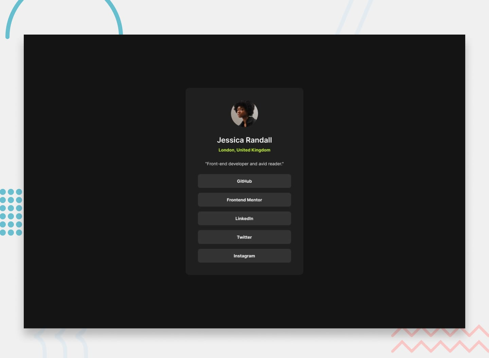

# Frontend Mentor - Social links profile solution

This is a solution to the [Social links profile challenge on Frontend Mentor](https://www.frontendmentor.io/challenges/social-links-profile-UG32l9m6dQ).

## Table of contents

- [Overview](#overview)
  - [The challenge](#the-challenge)
  - [Extra feature](#extra-feature)
  - [Screenshot](#screenshot)
  - [Links](#links)
- [My process](#my-process)
  - [Built with](#built-with)
  - [What I learned](#what-i-learned)
  - [AI Collaboration](#ai-collaboration)

## Overview

### The challenge

Users should be able to:

- See hover and focus states for all interactive elements on the page

### Extra feature

### Screenshot



### Links

- Repository URL: [GitHub Repo](https://github.com/MATBMS/social-links-profile)
- Live Site URL: [GitHub Page](https://matbms.github.io/social-links-profile/)

## My process

### Built with

- Semantic HTML5 markup
- CSS custom properties
- Flexbox
- CSS Grid
- Mobile-first workflow

### What I learned

#### Custom data attributes (`data-url`)

A `data-` attribute lets me store extra information on an HTML element. The browser ignores it, so it does not change how the element looks or behaves. I used it to keep the address of each social button on the button itself:

```html
<button class="link" type="button" data-url="https://github.com">
  <span class="link-text">GitHub</span>
</button>
```

In JavaScript, I read it with `dataset`:

```js
button.dataset.url; // "https://github.com"
```

- The part after `data-` becomes the property name: `data-url` becomes `dataset.url`.
- A name with dashes becomes camelCase: `data-link-name` becomes `dataset.linkName`.
- The value is always a string.
- The same script works for all five buttons, because each one carries its own address.
- The attributes are visible in the page source, so they must never hold secrets.

### AI Collaboration

This is a project where I act as the Product Engineer, not the developer. I define the requirements and validate every decision, and Claude Code writes the code.
