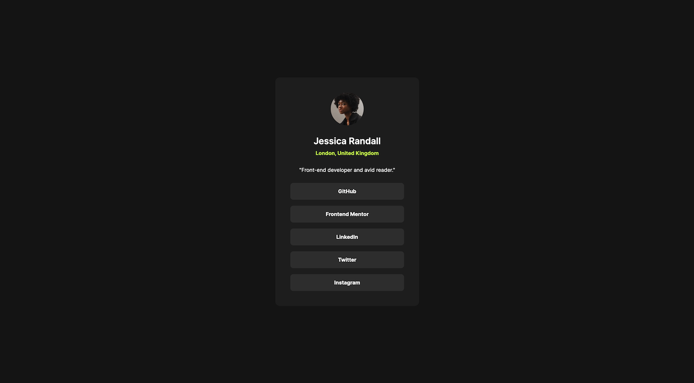
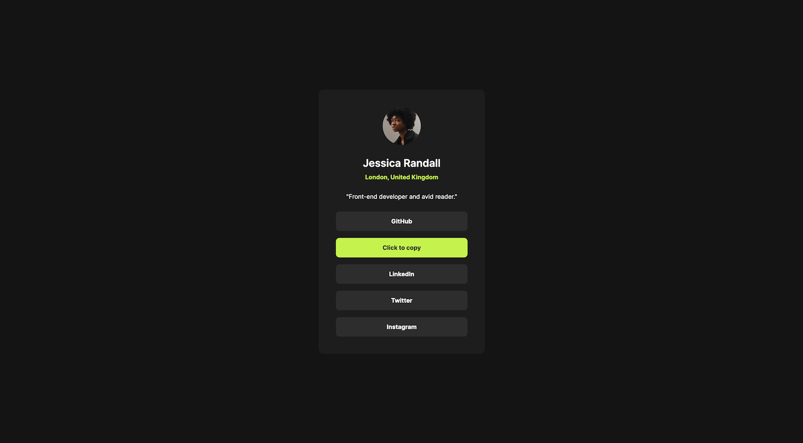
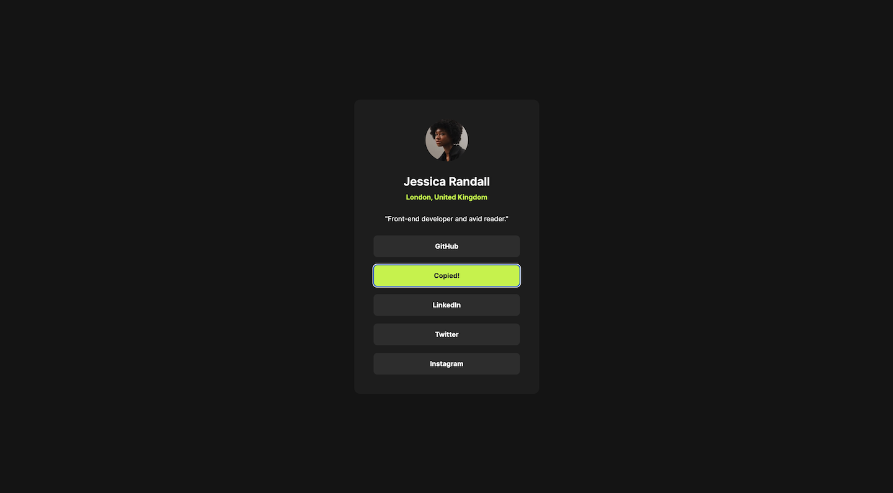

# Frontend Mentor - Social links profile solution

This is a solution to the [Social links profile challenge on Frontend Mentor](https://www.frontendmentor.io/challenges/social-links-profile-UG32l9m6dQ).

## Table of contents

- [Overview](#overview)
  - [The challenge](#the-challenge)
  - [Extra feature](#extra-feature)
  - [Screenshot](#screenshot)
  - [Links](#links)
- [My process](#my-process)
  - [Built with](#built-with)
  - [What I learned](#what-i-learned)
  - [AI Collaboration](#ai-collaboration)

## Overview

### The challenge

Users should be able to:

- See hover and focus states for all interactive elements on the page

### Extra feature

**As a** visitor of the profile,<br>
**I want to** click a social button and get its address copied,<br>
**so that** I can paste it where I need it.

### Screenshot

#### Preview


#### Desktop: default state



#### Desktop: hover state ("Click to copy")



#### Desktop: after a click ("Copied!")



### Links

- Repository URL: [GitHub Repo](https://github.com/MATBMS/social-links-profile)
- Live Site URL: [GitHub Page](https://matbms.github.io/social-links-profile/)

## My process

### Built with

- Semantic HTML5 markup
- CSS custom properties
- Flexbox
- JavaScript (Clipboard API)
- Mobile-first workflow

### What I learned

#### Custom data attributes (`data-url`)

A `data-` attribute lets me store extra information on an HTML element. The browser ignores it, so it does not change how the element looks or behaves. I used it to keep the address of each social button on the button itself:

```html
<button class="link" type="button" data-url="https://github.com">
  <span class="link-text">GitHub</span>
</button>
```

In JavaScript, I read it with `dataset`:

```js
button.dataset.url; // "https://github.com"
```

- The part after `data-` becomes the property name: `data-url` becomes `dataset.url`.
- A name with dashes becomes camelCase: `data-link-name` becomes `dataset.linkName`.
- The value is always a string.
- The same script works for all five buttons, because each one carries its own address.
- The attributes are visible in the page source, so they must never hold secrets.

#### Copying to the clipboard

The copy happens in a click listener in `script.js`:

```js
button.addEventListener("click", async () => {
  try {
    await navigator.clipboard.writeText(button.dataset.url);
    showMessage("Copied!");
  } catch {
    showMessage("Copy failed");
  }
});
```

- `navigator.clipboard.writeText(...)` is the browser's Clipboard API. It puts a string in the clipboard, here the address read from `data-url`.
- Copying can take a moment and the browser can refuse it, so `writeText` returns a promise (a value that will be ready later) instead of finishing at once.
- `await` pauses the function until the promise is done. It only works inside a function marked `async`, which is why the listener is `async`.
- If the copy works, the line after `await` runs and the message "Copied!" is shown.
- If the copy fails, for example because the browser blocks clipboard access, the promise is rejected, and the code jumps to `catch` and shows "Copy failed".
- `try` and `catch` let me handle that failure instead of leaving the visitor with no feedback.
- The Clipboard API only works on secure pages (HTTPS or `localhost`) and after a user action such as a click, so the copy is triggered by the click and not by the page load.

#### Other points to remember

- **`button` or `a`:** I use an `a` link to go to another page and a `button` to do an action, here copying an address. A `button` also works with the keyboard (Enter and Space) without extra code.
- **`:focus-visible`:** it matches an element that has keyboard focus, but not after a mouse click. I give it the same style as `:hover`, so keyboard users get the same feedback as mouse users.
- **Fading text with a class:** `.link-text.is-fading` (no space) matches an element that has both classes. My script adds `is-fading` to set `opacity: 0`, which hides the text but keeps its space, and the `transition` makes it fade.
- **Mobile-first with `min-width`:** the base styles are for small screens. A `min-width` media query adds or overrides rules from that screen size and above.

### AI Collaboration

This is a project where I act as the Product Engineer, not the developer. I define the requirements and validate every decision, and Claude Code writes the code.
